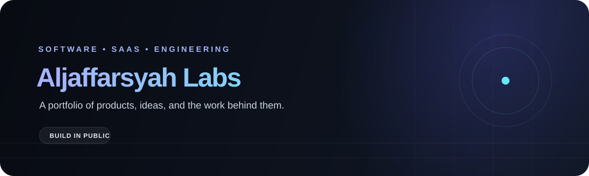
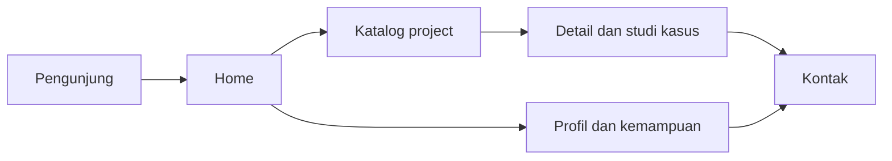

<div align="center">
  

  <p><strong>Portfolio untuk menampilkan ide, produk, dan proses di balik software yang dibangun.</strong></p>

  <p>
    
    
    
    
  </p>
</div>

## Tentang project

**Aljaffarsyah Labs** adalah website portfolio personal untuk mengumpulkan
proyek SaaS dan software dalam satu tempat. Website ini dirancang agar calon
klien, recruiter, founder, dan calon partner dapat mengenal profil developer,
menjelajahi project, membaca konteks pembuatannya, lalu menghubungi pemilik
portfolio.

Project ini menggunakan Next.js App Router dengan TypeScript. Konten project
ditampilkan melalui halaman katalog dan halaman detail berdasarkan slug.

## Alur website



## Fitur

### Sudah tersedia di aplikasi

- Homepage portfolio dengan hero, profil ringkas, pilihan project, dan bagian
  kontak.
- Halaman katalog di `/projects`.
- Halaman detail project di `/projects/[slug]`.
- Data project terstruktur dengan informasi overview, masalah, solusi,
  highlights, tech stack, dan metrik.
- Layout responsif berbasis Tailwind CSS.

### Dalam pengembangan

- Menyatukan sumber data project untuk homepage dan katalog.
- Memverifikasi konten contoh, tautan, gambar, dan klaim sebelum publikasi.
- Contact form dengan validasi dan pengiriman yang terkonfirmasi.
- Pengelolaan project oleh pemilik.
- Penyempurnaan metadata, aksesibilitas, dan kesiapan deployment.

> **Catatan:** konten project yang ada saat ini perlu diverifikasi. Jangan
> menganggap metrik, deskripsi, atau tautan contoh sebagai klaim produksi.
> Katalog juga belum memiliki pencarian/filter yang berfungsi.

## Teknologi

- [Next.js 16](https://nextjs.org/) — framework dan routing
- [React 19](https://react.dev/) — antarmuka
- [TypeScript](https://www.typescriptlang.org/) — type safety
- [Tailwind CSS 4](https://tailwindcss.com/) — styling
- [shadcn/ui](https://ui.shadcn.com/) — basis komponen UI
- [Zod](https://zod.dev/) dan [React Hook Form](https://react-hook-form.com/)
  tersedia untuk kebutuhan validasi form

## Menjalankan secara lokal

### Prasyarat

- Node.js dan npm
- Git

### Langkah

```bash
git clone <url-repository>
cd aljaffarsyah-labs
npm install
npm run dev
```

Buka [http://localhost:3000](http://localhost:3000).

Perintah yang tersedia:

```bash
npm run dev     # Menjalankan development server
npm run lint    # Menjalankan ESLint
npm run build   # Membuat production build
npm run start   # Menjalankan production build
```

## Struktur utama

```text
app/                  Route dan layout Next.js
  projects/           Katalog dan detail project
components/           Komponen layout, section, project, dan UI
constants/            Konfigurasi dan konstanta website
data/                 Data pendukung
lib/                  Helper dan akses data project
public/               Asset statis
types/                TypeScript types
assets/               Asset dokumentasi README
PRD.md                Kebutuhan produk dan acceptance criteria
PLAYBOOK.md           Workflow pengembangan 10 fase
```

## Dokumentasi project

- [PRD](./PRD.md) — tujuan, ruang lingkup MVP, kebutuhan, dan kriteria
  penerimaan.
- [Playbook](./PLAYBOOK.md) — tahapan pengembangan dari audit hingga launch.
- [Contoh PRD dan Playbook](./contoh%20PRD_AND_PLAYBOOK.md) — referensi format
  dokumen.

## Kontribusi dan pengembangan

Sebelum mengubah fitur, periksa [PRD](./PRD.md), [Playbook](./PLAYBOOK.md), dan
kondisi repository terkini. Kerjakan satu fase playbook pada satu waktu.
Jangan menambahkan data profil, metrik, testimoni, atau klaim project yang
belum dikonfirmasi pemilik.

## Status

Project ini sedang dikembangkan. Integrasi contact, pengelolaan konten, dan
konten final portfolio belum dinyatakan siap produksi.
